# Architecture — Rope Geometry (as implemented)

Audit date 2026-11-17 (UTC+8). Branch `feature/somerville-egc-knoto-id` @ `397d350`.
Tags: **[V]** verified fact, **[I]** reasonable inference, **[U]** unknown (defined in
[REPOSITORY_INVENTORY.md](REPOSITORY_INVENTORY.md)).

## 0. Summary

Rope Geometry is a **browser + Node.js JavaScript (ESM) project**: Vite 7, Three.js 0.180,
`node:test`, no TypeScript, no build step for Node scripts [V]. It is not a library with a
public API. It is a set of CLI scripts that write JSON, plus five static Three.js pages that read
that JSON [V].

The historical architecture diagram (topology → centerline → validation → physics →
reconstruction → Blender/Three.js) is **only partially reflected** in the code:

| Historical layer | What actually exists |
| --- | --- |
| Rope topology | **Six unconnected representations.** Only the Phase 2/3 toy topologies are compiled into geometry [V] |
| Centerline geometry | **One shared document format** (`src/schema.js`, JSON v1, metres, Z-up, diameter). The Somerville generators construct centerlines **procedurally from hand-tuned parameters, not from a topology ledger** [V] |
| Geometric / collision validation | Exists, in two generations: the frozen capsule kernel (`geometry.js`) and robust kernel + tube mesh checks (`robust-distance.js`, `rope-tube.js`) [V] |
| Physics backend | **None.** `rope-relax.js` is a geometric position-based solver with collision certification, not a mechanics model. `material-hemp-6mm.json` declares `analysisStatus: NOT_ENABLED` [V] |
| Geometry reconstruction | Tube mesh (`rope-tube.js`) used for validation and display. No three-strand geometry [V] |
| Blender | Import plus round-trip verifier (`scripts/blender_import.py`) for early fixtures only. Hard-coded macOS path, not in CI [V] |
| Three.js visualisation | Five independent viewer pages [V] |
| Semantic editor | `rope-edit.html` + `src/rope-edit-*.js`, a working prototype on the shared core [V] |

---

## 1. Entry points

### 1.1 Browser entry points (all in `vite.config.js` rollup input) [V]

| HTML | Module | Purpose | Data it loads |
| --- | --- | --- | --- |
| `index.html` | `src/viewer.js` | Phase 1–4B inspector (A/B/C, P2, P3, P4, P4B, P4R) | `data/experiments.json`, `B.json`, `C.json`, crossing/multiple JSON, both Somerville ledgers |
| `phase5.html` | `src/phase5-viewer.js` | Phase 5 Candidate A, partial cuff, recovery stages 1–4, integrated trial | `data/phase5-*.json`, `data/phase5-recovery/*.json` |
| `somerville.html` | `src/somerville-viewer.js` | Somerville tube viewer with acceptance badges | `data/somerville-final/{loose,loose-v2,continuation,final,dressed-candidate}.json`, `data/rope-examples/overhand.json`, `reports/somerville-dressed-report.json` |
| `rope-edit.html` | `src/rope-editor.js` | Semantic rope editor (bamboo workspace) | None at startup (fixture built in code); imports/exports session JSON |
| `at-70.html` | `src/at-70-viewer.js` | Rear-cuff permutation hypotheses at 70 s | None (geometry built in `src/at-70-model.js`) |

### 1.2 CLI entry points

There are 17 npm scripts in `package.json` plus 7 un-wired scripts. The full list, with verified exit
codes, is in [DEPENDENCIES.md](DEPENDENCIES.md) §3 [V].

---

## 2. Module dependency graph [V]

Edges are the literal `import … from './x.js'` statements in `src/` (extracted by grep during
this audit). There are **no circular imports** [V]. Scripts and tests are omitted for readability;
their consumers are listed in §3.

```mermaid
flowchart TB
  subgraph legacyKernel [Frozen PoC kernel]
    geometry[geometry.js]
    schema[schema.js]
    topology[topology.js]
    recoverySampling[recovery-sampling.js]
  end
  subgraph reviewKernel [Review kernel]
    robust[robust-distance.js]
    verification[verification.js]
  end
  subgraph ropeCore [Shared rope core]
    ropeState[rope-state.js]
    ropeFrames[rope-frames.js]
    ropeCurves[rope-curves.js]
    ropeTube[rope-tube.js]
    ropeLengths[rope-lengths.js]
    ropeRelax[rope-relax.js]
    ropeTargets[rope-targets.js]
    ropeAcceptance[rope-acceptance.js]
  end
  subgraph somerville [Somerville generators and evaluation]
    opTopo[operational-topology.js]
    build[somerville-build.js]
    dressed[somerville-dressed.js]
    verify[somerville-verify.js]
    poseFit[somerville-pose-fit.js]
    poseTargets[somerville-pose-targets.js]
    sRelax[somerville-relax.js shim]
  end
  subgraph ledgers [Topology ledgers and interchange]
    sTopo[somerville-topology.js]
    matTopo[material-topology.js]
    gaussEv[gauss-evidence.js]
    extGauss[extended-gauss.js]
  end
  subgraph historical [Phase 5 historical]
    phase5[phase5.js]
    recovery[phase5-recovery.js]
    repair[integration-repair.js]
  end
  subgraph editor [Semantic editor]
    editStep[rope-edit-step.js]
    editSession[rope-edit-session.js]
    editCamera[rope-edit-camera.js]
  end
  subgraph viewers [Three.js and DOM pages]
    viewer[viewer.js]
    p5viewer[phase5-viewer.js]
    sviewer[somerville-viewer.js]
    at70viewer[at-70-viewer.js]
    ropeEditor[rope-editor.js]
    matViewer[material-viewer.js]
    gallery[reference-gallery.js]
  end
  at70[at-70-model.js]
  overhand[overhand-recipe.js]

  schema --> geometry
  topology --> geometry
  recoverySampling --> geometry
  verification --> geometry
  verification --> robust
  verification --> schema
  ropeTube --> ropeFrames
  ropeTube --> ropeState
  ropeRelax --> robust
  ropeRelax --> ropeLengths
  ropeRelax --> ropeState
  ropeTargets --> ropeState
  overhand --> ropeCurves
  overhand --> ropeState
  build --> opTopo
  build --> robust
  build --> ropeCurves
  build --> ropeFrames
  build --> dressed
  dressed --> opTopo
  dressed --> ropeCurves
  dressed --> ropeFrames
  dressed --> ropeState
  dressed --> ropeTube
  verify --> ropeState
  verify --> schema
  poseTargets --> ropeState
  sRelax --> ropeRelax
  gaussEv --> extGauss
  gaussEv --> matTopo
  phase5 --> geometry
  recovery --> geometry
  repair --> recovery
  repair --> verification
  at70 --> verification
  editStep --> ropeLengths
  editStep --> ropeRelax
  editStep --> ropeState
  editStep --> ropeTube
  editSession --> editStep
  viewer --> geometry
  viewer --> schema
  viewer --> sTopo
  viewer --> matViewer
  viewer --> gallery
  matViewer --> matTopo
  p5viewer --> recovery
  p5viewer --> verification
  sviewer --> ropeTube
  sviewer --> schema
  at70viewer --> at70
  ropeEditor --> editStep
  ropeEditor --> editSession
  ropeEditor --> editCamera
  ropeEditor --> ropeTube
```

Leaf modules with no internal imports [V]: `geometry.js`, `robust-distance.js`, `rope-state.js`,
`rope-frames.js`, `rope-curves.js`, `rope-lengths.js`, `rope-acceptance.js`,
`operational-topology.js`, `somerville-pose-fit.js`, `somerville-topology.js`,
`material-topology.js`, `extended-gauss.js`, `rope-edit-camera.js`, `reference-gallery.js`.

Observations:

- Two kernel generations coexist. The **PoC/Phase 5 stack** uses `geometry.js` via `schema.js`, `topology.js`, `phase5*.js` and `viewer.js`. The **rope core stack** (`robust-distance.js`, `rope-*.js`) is used by Somerville and the editor. `verification.js` bridges them: it uses the robust kernel but imports `EPSILON` and `schema.js` from the old one [V].
- `somerville-build.js` → `somerville-dressed.js` is a one-way dispatch. The dressed generator does not reuse the v1/video code path; it is a separate construction [V].
- `somerville-pose-fit.js` has no internal imports. It implements its own projection and scoring [V].

---

## 3. Subsystems

Format: **Purpose → Inputs → Outputs → Dependencies → Consumers → Status**.

### 3.1 Document schema and animation — `src/schema.js`

- **Purpose:** validate, parse and serialise the JSON v1 geometry document; linear keyframe animation.
- **Inputs:** a JSON object `{schemaVersion:1, units:'m', coordinateSystem:'right-handed Z-up', ropes:[{id, diameter, points:[[x,y,z],…]}], animation?:{frames:[{time, ropes:[{id, points}]}]}}`. Defined in `validateDocument` (line 1) [V].
- **Outputs:** validated document; `evaluateAt` (line 27) interpolated ropes; `sampleAnimation` (line 39) / `detectAt` (line 51) collision reports per sample [V].
- **Dependencies:** `geometry.js` (`detectCollisions`).
- **Consumers:** `verification.js`, `somerville-verify.js`, `viewer.js`, `somerville-viewer.js`, `scripts/report.js`, tests [V].
- **Status:** IMPLEMENTED and tested (`test/geometry.test.js`). It is the **only canonical data contract** in the repository [V].

### 3.2 Collision kernels and clearance audit

| Module | Purpose | Key function | Consumers | Status |
| --- | --- | --- | --- | --- |
| `src/geometry.js` | Frozen PoC segment distance + capsule collisions; excludes only index-adjacent segments | `closestSegments` (l.11), `detectCollisions` (l.39) | schema, topology, phase5, phase5-recovery, recovery-sampling, viewer, report.js, recovery-diagnose.js | IMPLEMENTED, intentionally frozen. Has a documented near-parallel defect (`docs/cli-review.md`) [V] |
| `src/robust-distance.js` | Cross-product closest points, scale-stable | `robustClosestSegments` (l.4) | verification, rope-relax, somerville-build (`seedClearance`) | IMPLEMENTED, tested at 1e-6/1/1e6 scales [V] |
| `src/verification.js` | Capsule + infinite-column clearance audit for a document | `verifyGeometry` (l.6) | verify-geometry.js, integration-repair, at-70-model, phase5-viewer | IMPLEMENTED [V] |
| `src/recovery-sampling.js` | Subdivision sensitivity of capsule penetrations | `samplePolyline` (l.11) | verify-geometry.js, recovery-report.js | IMPLEMENTED, Phase 5-specific [V] |

### 3.3 Shared rope core

| Module | Purpose → Inputs → Outputs | Consumers | Status |
| --- | --- | --- | --- |
| `rope-state.js` | Material coordinate `s0`, separate from geometric arc length. Points + diameter → `{points, s0, restLengths, geometryArc, …}`; linear `materialSample`/`resampleMaterial`; rigid `toWorld`/`toLocal` | relax, tube, targets, overhand, editor, Somerville, evaluators | IMPLEMENTED [V] |
| `rope-frames.js` | Rotation-minimising (parallel-transport) frames `{t,n,b}` | rope-tube, somerville-build, somerville-dressed | IMPLEMENTED [V] |
| `rope-curves.js` | `line` / `hermite` / `torus-arc` curve segments → sampled polyline; `compileRecipe` | overhand-recipe (full recipe), Somerville builders (`hermitePoint` only) | IMPLEMENTED. **Somerville is not compiled through recipes** (`handoff.md`) [V] |
| `rope-tube.js` | `makeTube(points, radius, {radialSegments=12})` → triangle mesh; `checkTube` self-intersection, folded faces, column penetration | Somerville scripts/viewer, editor, overhand, tests | IMPLEMENTED. Static check only; false-positive fix on 2026-11-05 [V] |
| `rope-lengths.js` | Newton-type projection of all segment lengths on an open chain | rope-relax, rope-edit-step | IMPLEMENTED [V] |
| `rope-relax.js` | `relaxRope`: position-based relaxation with length projection, bend limit, nonlocal contact (`localArc = 4·d`), column contact, shape targets and linear-motion CCD (`certifyPairMotion`) | rope-edit-step, continue-somerville, generate-overhand, audit-rope-edit, tests | IMPLEMENTED. Defaults embed Somerville constants (`diameter 0.006`, `columnRadius 0.0275`) [V] |
| `rope-targets.js` | Targets at fixed material stations | continue-somerville only | IMPLEMENTED, used only by the historical continuation [V] |
| `rope-acceptance.js` | Roll-up of separately computed evidence into PASS/FAIL/UNVERIFIED; missing evidence never passes | evaluate-somerville-{dressed,candidate} | IMPLEMENTED [V] |
| `somerville-relax.js` | Re-export of `relaxRope`, `candidatePairs` | test/somerville-relax.test.js, work/ | Compatibility shim [V] |

### 3.4 Topology ledgers and interchange

| Module / data | Purpose | Status |
| --- | --- | --- |
| `src/topology.js` + `data/crossing-topology.json`, `data/multiple-crossings-topology.json` | Phase 2/3: ordered path + crossings (segment, t, over) → cosine-lifted centerline + validators | IMPLEMENTED for 1–2 crossings; "not a general knot solver" (README) [V] |
| `src/somerville-topology.js` + `data/somerville-bowline-topology.json` (v1) | Phase 4 object/relationship/path ledger + SVG | IMPLEMENTED validator; reference validation `PARTIAL_REFERENCE_RECONSTRUCTION` [V] |
| `src/material-topology.js` + `data/somerville-bowline-topology-v2.json` (v2) | Phase 4B evidence ledger: fragments, ports, evidence images, D8 construction crossings | IMPLEMENTED validator; inventory valid, **path incomplete** (`audit:somerville`, run during audit) [V] |
| `src/operational-topology.js` | Declared operation sequence and route facts for the generators | IMPLEMENTED as data; embedded in generated documents [V] |
| `src/gauss-evidence.js`, `src/extended-gauss.js`, `data/somerville-gauss-review.json`, `scripts/export-knoto-id.js` | Extended Gauss code / Knoto-ID export, gated by the v2 ledger | IMPLEMENTED gate; Somerville export **BLOCKED by design** (`ready:false`) [V] |
| `data/phase5-topology-A.json` | Phase 5 engineering hypothesis parameters + claims | HIST [V] |

### 3.5 Somerville generators and evaluation

- **Purpose:** produce a metric centerline of a right-handed two-wrap Somerville Bowline around a column, then evaluate it against operation checks, tube validity and a 148 s video frame.
- **Inputs:** preset parameters (`SOMERVILLE_PRESETS` in `src/somerville-build.js` l.15; `DRESSED_PRESETS` in `src/somerville-dressed.js` l.32), `operationalTopology`, `data/somerville-pose148.json` [V].
- **Outputs:** JSON v1 documents with an extra `somerville` metadata block (stage, route, config, operations, sections, materialArc, column, ribbon, rollAnchors, material, modellingChoices, acceptance) [V], plus reports.
- **Dependencies:** rope core, robust kernel, operational topology.
- **Consumers:** `somerville.html`, tests, evaluators.
- **Status:**
  - `route:'v1'` (`loose.json`): HIST. Contradicts the ledger diagonal/under direction per `operational-topology.js` [V].
  - `route:'video'` (`loose-v2.json`): HIST, but still the viewer default and a test fixture [V].
  - `route:'dressed'` (`buildDressedSomerville`, l.78): **current**. The seed freezes; the pose is FAIL and motion is UNVERIFIED. Reproduced during this audit (exit 0, RMS 109.44 px) [V].
  - `validateOperations` (`src/somerville-verify.js` l.9) checks route realisation, explicitly "not isotopy / source-pose certificate" [V].
  - `fitPoseCamera` / `scorePose` (`src/somerville-pose-fit.js` l.296/l.536): orthographic similarity fit with a scale-calibration clamp [V].

### 3.6 Phase 5 and recovery (historical)

`src/phase5.js` (`generateCandidate`, `validateCandidate`, `generatePartialCuff`) and
`src/phase5-recovery.js` (`generateCoreStage`, `integrateCore`), with `src/integration-repair.js`
(`assessIntegratedRepair`). They use the frozen `geometry.js` kernel and 10 mm rope [V].

Status: **failed geometry, retained as regression baselines.** Candidate A has 36 penetrating pairs;
the integrated trial has 74 (reproduced by `npm run verify:geometry` during this audit) [V].

### 3.7 at-70 hypotheses — `src/at-70-model.js`, `src/at-70-viewer.js`

Three clearance-checked schematic variants (A/B/C) of the rear-cuff limb exchange at about 70 s;
diameter about 9.8 mm, column radius 0.092 m. `claims.topologyVerified: false` [V].

Status: EXPERIMENTAL, standalone. It does not feed any other pipeline [V].

### 3.8 Semantic rope editor — `rope-edit.html`

- **Purpose:** interactive desktop editing. A mode = camera; B mode = drag a rope handle while the solver keeps length, collision and tube validity.
- **Inputs:** `buildBambooFixture()` (default, `bamboo-u-v1`) or legacy `buildEditorFixture()` (`loose-bight-v1`); session JSON for replay [V].
- **Outputs:** session JSON (schema v2: steps, timeline, SHA-256 per step) [V].
- **Dependencies:** `rope-state`, `rope-relax`, `rope-lengths`, `rope-tube`. It reuses the core and does not reimplement kernels [V].
- **Consumers:** human user; `scripts/audit-rope-edit.mjs`; tests.
- **Status:** PROTOTYPE. The three archived `loose-bight-v1` sessions re-verify (`audit-rope-edit.mjs`, run during audit: `verified:true`, 0 invalid motions) [V]. The bamboo workspace has unit tests but no archived acceptance session [V]. Human trials are pending (`reports/rope-edit/README.md`) [V].

### 3.9 Rendering adapters (Three.js)

Five independent page scripts. Each builds its own scene, camera, lights and controls [V].
Tube meshes come from `rope-tube.js` only in `somerville-viewer.js` and `rope-editor.js`. The other
three draw per-segment cylinders or capsules [V]. Geometry generation is **not** mixed into the
viewers, with one exception: `at-70-viewer.js` and `rope-editor.js` build their geometry in-browser
from model code rather than loading JSON [V].

### 3.10 Export / external integrations

| Integration | Files | Status |
| --- | --- | --- |
| Blender | `scripts/blender_import.py`, `verify-blender.js`, `phase5-blender.py`, `phase5-verify-blender.js` | Covers Phase 1–3 and Phase 5 fixtures only; hard-coded `/Applications/Blender.app/...`; not run in this audit (no Blender) [V]. No Blender path exists for Somerville or editor output [V] |
| Knoto-ID | `scripts/export-knoto-id.js` (`gauss` / `xyz`) | XYZ export works for any metric doc [I]; Gauss export blocked for Somerville [V]. The Knoto-ID executable is not bundled [V] |
| Video/image evidence | `references/`, `work/somerville/frames/`, `scripts/overlay-dressed.js` | Overlay needs macOS `sips` for JPEG decoding; otherwise draws a dark background [V] |

---

## 4. Competing implementations of the same concept [V unless marked]

| Concept | Implementations | Notes |
| --- | --- | --- |
| Segment–segment distance | `geometry.js:closestSegments`, `robust-distance.js:robustClosestSegments` | Deliberate: the old one is frozen for baseline hashes. They agree to 1.12e-16 m on Phase 5 fixtures (`docs/cli-review.md`) but differ on near-parallel input |
| Nonlocal pair exclusion | (a) index adjacency `|i−j|=1`: `geometry.js`, `verification.js`, `topology.js`, `recovery-sampling.js`; (b) arc-length window `4·d`: `rope-relax.js:candidatePairs` (l.43, l.61), `somerville-build.js:seedClearance` (l.128), editor (24 mm at 6 mm diameter, `reports/rope-edit/README.md`) | Collision counts from (a) and (b) are not comparable. Subdivision changes (a)'s exclusion set (`docs/cli-review.md`) |
| Clearance definition | `d − rA − rB` (geometry, verification); `diameter − distance` penetration (recovery-sampling); contact floor `d + gap/2` (rope-relax); `distance − d` (seedClearance); triangle-level tube checks (rope-tube) | Same semantics (sum of radii), different reporting forms. Tube checks are a different geometric object (mesh, not capsules) |
| Column / obstacle distance | `verification.js`, `rope-relax.js:axisDistance`, `phase5.js`, `somerville-build.js:seedClearance`, `rope-tube.js:checkTube` (mesh) | Infinite cylinder each time; column axis X (Somerville, Phase 5, at-70) vs. Y (bamboo editor) |
| Rigid frames | `rope-state.js:toWorld/toLocal`, `phase5-recovery.js:toWorld/toLocal` (l.26–27) | Duplicate helper |
| Somerville centerline generators | `somerville-build.js` v1, video; `somerville-dressed.js`; `phase5.js` Candidate A; `phase5-recovery.js` stages; `at-70-model.js`; `work/somerville/reuse/compact-route-prototype.js` | Seven constructions of (parts of) the same knot. None derived from a topology ledger |
| Knot generators (general) | `topology.js` (cosine-lift crossings), `rope-curves.js:compileRecipe` (overhand), Somerville builders | No shared recipe/topology compiler |
| Topology representations | Phase 2/3 crossing JSON, Phase 4 v1 ledger, Phase 4B v2 ledger, `operationalTopology`, Gauss review, `phase5-topology-A.json` | No converters between them, except gated Gauss binding |
| Rope diameter | 10 mm (Phase 1–5 fixtures, both ledgers), 6 mm (Somerville, hemp record, editor), ≈9.8 mm (at-70) | Explicit and documented per dataset, but no shared material record is consumed |
| Column radius | 0.055 m (Phase 5), 0.0275 m (Somerville), 0.092 m (at-70), 0.012 m (legacy editor), bamboo culm (editor) | Per-model constants |
| Viewer scaffolding | `viewer.js`, `phase5-viewer.js`, `somerville-viewer.js`, `at-70-viewer.js`, `rope-editor.js` | Five scene/camera/light/column setups; four use OrbitControls, the editor has custom camera math |
| Relax entry point | `rope-relax.js`, `somerville-relax.js` (shim) | |
| Generated file pairs | `loose-v3.json` ≡ `dressed-candidate.json` (byte-identical) | |

---

## 5. Is there a canonical source of truth?

| Concern | Canonical? | Evidence |
| --- | --- | --- |
| Geometry document format | **Yes.** `src/schema.js` JSON v1 (metres, right-handed Z-up, `diameter`, `[x,y,z]` polylines). All 25 tracked geometry documents under `data/` and `reports/` pass `validateDocument` (checked during this audit): 10 mm for the PoC and Phase 5 files, 6 mm for Somerville and overhand | [V] |
| Coordinate system | **Yes** for the document (Z-up). Column axis is per-model (X in Somerville/Phase 5/at-70, Y for the bamboo editor) and stored in metadata, not in the schema | [V] |
| Radius vs diameter | **Consistent:** `diameter` is stored and radius = diameter/2 everywhere it was checked. A past diameter-as-radius bug in tube checks was found and fixed (handoff 2026-11-04) | [V] |
| Current Somerville geometry | **Declared, not structural:** `handoff.md` and README name `data/somerville-final/loose-v3.json`, but the viewer defaults to `loose-v2` and does not list `loose-v3` by name | [V] |
| Knot topology | **No.** The v2 ledger calls itself "authoritative observation record" (`docs/somerville-egc-integration.md`), but it is incomplete and no generator consumes it. The generators follow `operationalTopology` plus hand-tuned parameters | [V] |
| Collision kernel | **No single kernel.** Two distance kernels and two exclusion policies coexist on purpose | [V] |
| Material properties | **No.** `material-hemp-6mm.json` is not consumed by code | [V] |

---

## 6. Tests (26 files, 146 tests) [V]

The run was observed during the audit on Node 22.23.4 Linux: **145 pass, 1 fail** (see [DEPENDENCIES.md](DEPENDENCIES.md)).

| Test file | Modules exercised |
| --- | --- |
| `geometry.test.js` | geometry, schema, topology (Phase 1–3) |
| `verification.test.js` | verification, integration-repair (Phase 5 baselines) |
| `robust-distance.test.js` | robust-distance |
| `recovery.test.js` | phase5-recovery, recovery-sampling (hashes `reports/phase5-recovery/baseline.json`) |
| `phase5.test.js` | phase5 |
| `somerville.test.js` | somerville-topology (Phase 4) |
| `material-topology.test.js`, `reference-gallery.test.js` | Phase 4B ledger |
| `gauss-evidence.test.js`, `extended-gauss.test.js`, `export-gate.test.js` | Gauss / Knoto-ID gate |
| `rope-core.test.js` | somerville-build, rope-tube/frames/state/acceptance. **Contains the failing bit-exact `loose-v2.json` test** |
| `rope-tube.test.js`, `rope-lengths.test.js`, `rope-motion.test.js`, `somerville-relax.test.js` | rope core |
| `somerville-route.test.js`, `somerville-dressed.test.js` | Somerville generators |
| `somerville-pose-fit.test.js`, `somerville-pose-invariance.test.js`, `somerville-dressed-acceptance.test.js` | pose fit + evaluator |
| `rope-edit.test.js`, `rope-edit-incremental.test.js`, `rope-edit-bamboo.test.js`, `rope-edit-camera-review.test.js` | editor |
| `at-70-model.test.js` | at-70 |

Not covered by any test [V]: the five viewer modules (except static HTML/vite checks in
`at-70-model.test.js`), `march-dressed.js`, `overlay-dressed.js`, Blender scripts, and
`generate-somerville.js` as a script (its output is checked indirectly by `rope-core.test.js`).
