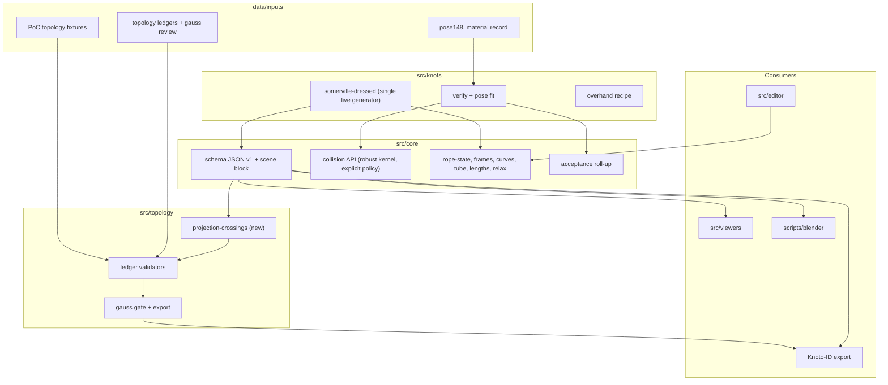
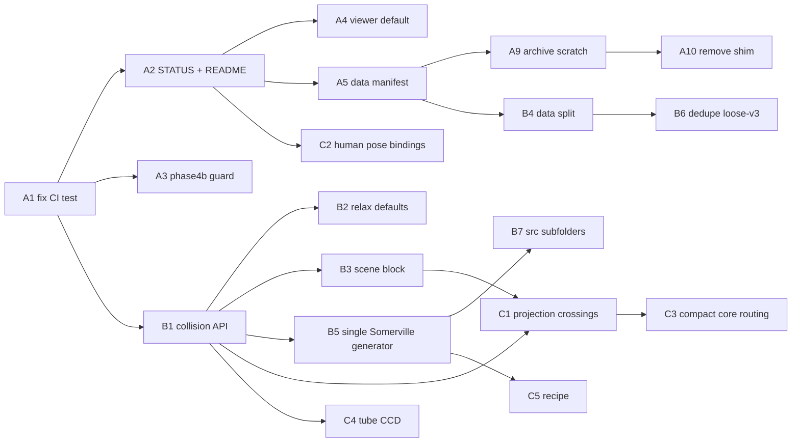

# Cleanup and Migration Plan — Rope Geometry

Audit date 2026-11-17 (UTC+8). Branch `feature/somerville-egc-knoto-id` @ `397d350`.
Tags: **[V]** verified fact, **[I]** reasonable inference, **[U]** unknown.

**These are recommendations only. Nothing was moved, renamed, deleted or refactored during this
audit.** Issue IDs (TD-xx) refer to [TECHNICAL_DEBT.md](TECHNICAL_DEBT.md).

## 0. Principles

1. **Restore trustworthy verification before changing structure.** CI is red (TD-01), so no refactor can currently be verified automatically.
2. **Preserve failure records.** Phase 5, recovery and historical Somerville candidates are deliberate negative baselines that tests depend on. Archive them; do not delete them.
3. **Compare with tolerances, not bytes, across platforms.** Bytes still matter within one run (TD-02).
4. **Stay a small flat JavaScript repo.** No TypeScript migration, monorepo, packages, plugin system or physics abstraction is justified by the current maturity [I].
5. **Do not invent missing topology.** Consolidation must not turn an assumption into a "canonical" fact (TD-03).

---

## 1. Proposed target architecture

The candidate tree from the audit brief (`core/`, `animation/`, `physics/`, `adapters/`, …) is
adapted to what actually exists. **There is no `physics/` and no `animation/` directory**: no physics
code exists, and animation is a field of the schema plus editor playback, not a subsystem. Blender
stays a pair of scripts, not an "adapter layer".

```text
rope-geometry/
├── index.html, phase5.html, somerville.html, rope-edit.html, at-70.html   (Vite entries stay at root)
├── src/
│   ├── core/          schema.js, robust-distance.js, collision.js (new: one API, explicit exclusion policy),
│   │                  rope-state.js, rope-frames.js, rope-curves.js, rope-tube.js, rope-lengths.js,
│   │                  rope-relax.js, rope-targets.js, rope-acceptance.js
│   ├── topology/      topology.js (PoC crossings), somerville-topology.js, material-topology.js,
│   │                  operational-topology.js, gauss-evidence.js, extended-gauss.js,
│   │                  projection-crossings.js (new, Phase C)
│   ├── knots/         somerville-dressed.js (+ presets and seedClearance moved from somerville-build.js),
│   │                  somerville-verify.js, somerville-pose-fit.js, somerville-pose-targets.js,
│   │                  overhand-recipe.js, at-70-model.js
│   ├── editor/        rope-edit-step.js, rope-edit-session.js, rope-edit-camera.js
│   ├── viewers/       viewer.js, phase5-viewer.js, somerville-viewer.js, at-70-viewer.js, rope-editor.js,
│   │                  material-viewer.js, reference-gallery.js, scene.js (optional shared helper)
│   └── legacy/        geometry.js (frozen kernel), recovery-sampling.js, phase5.js, phase5-recovery.js,
│                      integration-repair.js, somerville-build.js (v1/video routes only)
├── scripts/           unchanged names; blender/ subfolder for the two .py + two .js Blender scripts
├── data/
│   ├── inputs/        hand-authored: PoC fixtures, topology ledgers, gauss review, pose148, material record
│   ├── fixtures/      frozen test baselines (loose-v2, final, phase5*, rope-edit sessions, …)
│   └── generated/     current outputs (loose-v3 + its reports), each listed in a manifest with its writer
├── archive/           historical Somerville candidates, work/ scratch, superseded reports (with README)
├── references/        unchanged (evidence; hashes recorded in the v2 ledger)
├── test/              unchanged
└── docs/              STATUS.md (new), README restructured, audit/, existing ledgers
```



What changes conceptually: the projection-crossings extractor provides the first mechanical link
from geometry back to the topology evidence. It compares; it does not generate. Every other arrow
already exists today.

---

## 2. Phase A — Safe cleanup (minimal behavioural risk)

| # | Action | Files affected | Benefit | Depends on | Risks | Required verification | Order |
| --- | --- | --- | --- | --- | --- | --- | --- |
| A1 | Replace the bit-exact `loose-v2` comparison with (a) an in-process determinism check (build twice, `deepEqual`) and (b) a tolerance comparison (≤ 1e-12 m) against the committed fixture | `test/rope-core.test.js` | CI green on Linux (TD-01); unblocks CI `verify:geometry` + `build` | — | Weakening the test's intent | `npm test` on Linux and macOS; confirm a deliberate 1e-9 m perturbation still fails | **1** |
| A2 | Add `docs/STATUS.md`: current deliverable, gate values, open items, exact commands, platform caveats. Add a "Current / History" split to README; README mentions `rope-edit.html` and `at-70.html`; mark `handoff.md` as an archive log | `README.md`, new `docs/STATUS.md`, `handoff.md` header line | One trustworthy status (TD-07) | — | None functional | Review against this audit | 2 |
| A3 | Investigate and fix the `report:phase4b` guard (refresh the `src/topology.js` baseline entry with a reason, or exclude non-ledger files) | `reports/phase4b/baseline-sha256.json` or `scripts/report-phase4b.js` | Phase 4B regenerable (TD-04) | — | Masking a real change | `npm run report:phase4b` regenerates `diagrams/phase4b/*` byte-identically | 3 |
| A4 | Add a `loose-v3` option to the Somerville viewer as default; label historical options | `somerville.html`, `src/somerville-viewer.js` (option map only) | People see the current model (TD-08) | — | Viewer regressions (no tests) | Manual browser check of all options | 4 |
| A5 | Write a generated-file manifest (from DATA_FLOW §2): file → writer → npm script → current/historical/fixture | new `data/MANIFEST.md` (or JSON) | Makes "safe to overwrite / delete" explicit (TD-09) | — | Manifest drift | A test that every manifest writer exists (optional) | 5 |
| A6 | Expose un-wired scripts as npm scripts or document them: `generate-somerville.js`, `generate-overhand.js`, `audit-rope-edit.mjs`, `solve-somerville-pose.js` (marked historical) | `package.json`, README | Discoverability | A2 | None | Run each new npm script once | 6 |
| A7 | Blender: `BLENDER` env var with PATH fallback. Overlay: fail with a clear message, or stamp the output, when `sips` is missing | `scripts/verify-blender.js`, `scripts/phase5-verify-blender.js`, `scripts/overlay-dressed.js` | Cross-platform tooling (TD-11) | — | Low | Run on macOS with Blender; run overlay on Linux and check the message | 7 |
| A8 | Record platform/Node version next to every recorded SHA in new reports; annotate existing SHAs in `handoff.md`/STATUS as "macOS" | evaluators' metadata output, docs | Honest reproducibility (TD-02, partial) | A2 | Report SHAs change if metadata is added | Re-run `generate:dressed`; compare gate values with tolerance | 8 |
| A9 | Move `work/somerville/`, `reports/rope-reuse-*.json`, `reports/somerville-dressed-baseline.json` into `archive/` with a README. Delete `reports/phase5/*.blend1` after confirmation | listed files; `.gitignore` (`*.blend1`) | Less noise (TD-16) | A5 | Broken path citations in docs/reports | `rg` for every moved path before moving; `npm test` | 9 |
| A10 | Point `test/somerville-relax.test.js` at `rope-relax.js`; remove the `somerville-relax.js` shim after `work/` is archived | `test/somerville-relax.test.js`, `src/somerville-relax.js` | One solver entry point (TD-14) | A9 | `work/` scripts break (already archived) | `npm test` | 10 |

## 3. Phase B — Architectural consolidation (requires validation)

| # | Action | Files affected | Benefit | Depends on | Risks | Required verification | Order |
| --- | --- | --- | --- | --- | --- | --- | --- |
| B1 | Introduce `src/core/collision.js`: one capsule/clearance API on `robustClosestSegments`, with `exclusion: {kind:'index'} \| {kind:'arc', length}` reported in every result. Migrate `verification.js`, `viewer.js`, `seedClearance`, `candidatePairs` callers. Keep `geometry.js` frozen for the baseline tests only | `src/verification.js`, `src/viewer.js`, `src/somerville-build.js`, `src/rope-relax.js`, new `src/core/collision.js` | Comparable collision numbers (TD-05) | A1 | Phase 5 counts (36/74) must still reproduce under the index policy | `npm run verify:geometry` unchanged; `npm test`; dressed seed gates unchanged | 1 |
| B2 | Remove Somerville defaults from `relaxRope` (diameter required, column optional/explicit); update callers | `src/rope-relax.js`, `scripts/continue-somerville.js`, `scripts/generate-overhand.js`, `src/rope-edit-step.js`, tests | Shared core honours its contract (TD-06) | A1 | Silent change in historical outputs | Tolerance comparison of `overhand.json`; editor sessions re-verify (`audit-rope-edit.mjs`) | 2 |
| B3 | Standardise optional `scene` (obstacles: axis, center, radius, length) and `material` (id or inline diameter) blocks in JSON v1; validators accept the blocks without requiring them | `src/schema.js`, generators, viewers that hard-code columns | One place for scale constants (TD-12) | B1 | Schema changes ripple into 25 documents | `validateDocument` on all 25 docs; old docs still valid | 3 |
| B4 | Split `data/` into `inputs/`, `fixtures/`, `generated/`; move root-level reports into `reports/`; update fetch paths, tests, scripts and the `vite.config.js` copy list | `data/**`, root `*report*.json`, `src/*viewer*.js`, `scripts/*`, `test/*`, `vite.config.js` | Clear provenance (TD-09) | A5, A9 | Many hard-coded paths; build-time copy | `npm test`; `npm run build`; open every viewer option | 4 |
| B5 | Freeze `loose.json`, `loose-v2.json`, `continuation.json`, `final.json` as fixtures. Move v1/video code paths of `somerville-build.js` to `src/legacy/`; move presets used by the dressed scripts and `seedClearance` next to `somerville-dressed.js` | `src/somerville-build.js`, `src/somerville-dressed.js`, scripts importing `buildSomerville`, tests | One live Somerville generator (TD-10) | A1, B1 | `rope-core.test.js` / `somerville-route.test.js` depend on v1/video building | `npm test`; `npm run generate:dressed` gate values identical within tolerance | 5 |
| B6 | Collapse `dressed-candidate.json` / `loose-v3.json` duplication into one file plus a `frozen` status field (or keep both, with the manifest declaring the relation) | `scripts/generate-somerville-dressed.js`, `scripts/evaluate-somerville-dressed.js`, `somerville.html`, tests | No silent duplicates | B4 | Evaluator, viewer and tests reference both names | `npm test`; viewer check | 6 |
| B7 | Move `src/` into the subfolders of §1 (imports and HTML `<script src>` updated) | `src/**`, `*.html`, `scripts/*`, `test/*` | Responsibilities visible in the tree | B1–B5 | Large mechanical diff | `npm test`; `npm run build`; all viewers load | 7 |
| B8 | Decide on coordinate quantisation for serialised outputs (for example 1e-12 m) for cross-platform byte stability; update recorded hashes once | generators, `handoff.md`/STATUS, baselines | Cross-platform SHAs (TD-02) | A8 | All hashes change once; baseline tests must be re-pinned | Generate on macOS and Linux and compare bytes | 8 |
| B9 | Optional: extract `src/viewers/scene.js` (renderer, camera, lights, resize, column mesh) when a viewer is next touched | viewer modules | Less duplication (TD-15) | B7 | No automated viewer tests | Manual check of all 5 pages | 9 |

## 4. Phase C — Functional improvements (only after A and B)

| # | Action | Files affected | Benefit | Depends on | Risks | Required verification | Order |
| --- | --- | --- | --- | --- | --- | --- | --- |
| C1 | `projection-crossings.js`: from any JSON v1 centerline and a view direction, extract the ordered crossing sequence with over/under and sign. Compare it with Phase 2/3 fixtures (known answers), the ledger's partial records and `operationalTopology` route facts | new `src/topology/projection-crossings.js`, tests | First mechanical geometry → topology check (TD-03) | B1, B3 | Projection degeneracies; tempting to over-claim | Known-answer tests on PoC fixtures and the overhand | 1 |
| C2 | Human review of the two `pose148` crossing bindings, then re-run `generate:dressed` | `data/somerville-pose148.json` | Turns `crossingPose` UNVERIFIED into a real result | A2 | Reviewer bias from the overlay (warned in `handoff.md`) | Evaluator re-run; reviewer recorded | 2 |
| C3 | Generator routing change for a compact core (`loop-to-cuff` bend, `over-root` depth relative to `fold`), as concluded by the march | `src/somerville-dressed.js` (or its successor) | Path toward static pose PASS | B5, C1 | Topology drift while chasing the pose | Seed gates, C1 crossing sequence unchanged, pose RMS | 3 |
| C4 | Tube-level continuous collision (swept capsules or conservative advancement of the tube) for editor and continuation steps | `src/core/collision.js`, `src/rope-relax.js`, `src/editor/*` | Closes the documented certification gap | B1 | Performance in the editor | Negative tests (fast pass-through), editor latency | 4 |
| C5 | Express the dressed route through `rope-curves.js:compileRecipe` | `src/knots/*`, `src/core/rope-curves.js` | Reusable knot description; enables other knots | B5 | Large generator rewrite | Tolerance-equal output to the frozen `loose-v3` | 5 |
| C6 | Editor: archived acceptance session for the bamboo workspace; human trials; Somerville doubled strands | `src/editor/*`, `reports/rope-edit/*` | Editor moves beyond prototype | A1 | — | `audit-rope-edit.mjs` on new sessions | 6 |
| C7 | Loose-to-tight motion with an animation export (JSON v1 `animation.frames`) that the Blender importer can also consume | `scripts/continue-somerville.js` successor, `scripts/blender_import.py` | Animation pipeline end to end | C3, C4 | Topology preservation must be checked per frame (C1) | Frame-wise C1 + tube checks | 7 |
| C8 | Physics backend (homogenized Cosserat rod) and visual three-strand rendering, **only if** still needed after C1–C7 | new modules | — | C1–C7 | Premature generalisation | — | 8 |

---

## 5. File-level recommendations

| Recommendation | Meaning |
| --- | --- |
| **KEEP** | Leave in place, possibly with small edits |
| **CONSOLIDATE** | Merge with a duplicate or redesign behind one API |
| **RELOCATE** | Keep the content, move it in the tree |
| **ARCHIVE** | Move to `archive/` with a README; keep it readable and cited |
| **DELETE_CANDIDATE** | Proposed for deletion after confirmation |
| **INVESTIGATE** | Purpose or provenance must be established first |

### 5.1 Source (`src/`)

| File | Recommendation | Reason |
| --- | --- | --- |
| `schema.js` | KEEP (RELOCATE to `core/`) | Canonical document contract |
| `robust-distance.js` | KEEP (RELOCATE to `core/`) | Basis of the unified collision API |
| `verification.js` | CONSOLIDATE into `core/collision.js` (B1) | Mixes kernels and policies |
| `geometry.js` | KEEP frozen (RELOCATE to `legacy/`) | Baseline hashes and tests; not for new code |
| `topology.js` | KEEP (RELOCATE to `topology/`) | Only working topology → geometry compiler (PoC) |
| `recovery-sampling.js`, `phase5.js`, `phase5-recovery.js`, `integration-repair.js` | RELOCATE to `legacy/` | Historical baselines exercised by tests and `verify:geometry` |
| `rope-state.js`, `rope-frames.js`, `rope-curves.js`, `rope-tube.js`, `rope-lengths.js`, `rope-acceptance.js` | KEEP (RELOCATE to `core/`) | Shared core |
| `rope-relax.js` | KEEP, CONSOLIDATE defaults (B2) | Shared solver with Somerville defaults |
| `rope-targets.js` | KEEP (RELOCATE to `core/`) | Only used by historical continuation; small |
| `somerville-relax.js` | DELETE_CANDIDATE (A10) | Re-export shim |
| `operational-topology.js`, `somerville-topology.js`, `material-topology.js`, `gauss-evidence.js`, `extended-gauss.js` | KEEP (RELOCATE to `topology/`) | Evidence and interchange layer |
| `somerville-dressed.js`, `somerville-verify.js`, `somerville-pose-fit.js`, `somerville-pose-targets.js` | KEEP (RELOCATE to `knots/`) | Current pipeline |
| `somerville-build.js` | CONSOLIDATE (B5): presets/`seedClearance` to dressed; v1/video to `legacy/` | Hosts both live and superseded routes |
| `overhand-recipe.js`, `at-70-model.js` | KEEP (RELOCATE to `knots/`) | Migration example; standalone hypothesis model |
| `rope-edit-step.js`, `rope-edit-session.js`, `rope-edit-camera.js` | KEEP (RELOCATE to `editor/`) | Editor prototype |
| `viewer.js`, `phase5-viewer.js`, `somerville-viewer.js`, `at-70-viewer.js`, `rope-editor.js`, `material-viewer.js`, `reference-gallery.js` | KEEP (RELOCATE to `viewers/`); `viewer.js` moves to the unified kernel (B1) | Five entry pages |

### 5.2 Scripts (`scripts/`)

| File | Recommendation | Reason |
| --- | --- | --- |
| `verify-geometry.js`, `audit-somerville.js`, `export-knoto-id.js`, `generate-somerville-dressed.js`, `evaluate-somerville-dressed.js`, `dressed-pipeline.js`, `march-dressed.js`, `report.js`, `generate-crossing.js`, `report-phase4.js`, `generate-overhand.js`, `audit-rope-edit.mjs` | KEEP | Live commands |
| `report-phase4b.js` | KEEP, fix guard (A3) | Currently aborts |
| `overlay-dressed.js` | KEEP, fix platform fallback (A7) | macOS-only background |
| `blender_import.py`, `verify-blender.js`, `phase5-blender.py`, `phase5-verify-blender.js` | RELOCATE to `scripts/blender/`; fix path (A7) | Platform-locked |
| `phase5-report.js`, `recovery-diagnose.js`, `recovery-report.js` | KEEP (historical generators of frozen baselines) | Regenerate the baselines tests check |
| `generate-somerville.js`, `continue-somerville.js`, `evaluate-somerville-candidate.js`, `solve-somerville-pose.js` | ARCHIVE after B5 freezes their outputs | Superseded pipeline |
| `author-phase4b.py`, `collect-phase4b.py` | ARCHIVE (keep runnable) | One-shot authoring of evidence; ffmpeg + absent videos |

### 5.3 Data, reports, docs and other files

| Path | Recommendation | Reason |
| --- | --- | --- |
| `data/experiments.json`, `B.json`, `B-clear.json`, `C.json`, `crossing-topology.json`, `multiple-crossings-topology.json` | KEEP (RELOCATE to `data/inputs/`) | Hand-authored PoC inputs |
| `data/crossing-valid.json`, `multiple-*.json` | KEEP (RELOCATE to `data/generated/`) | Regenerable, byte-stable |
| `data/crossing-invalid.json`, `crossing-report.json` | INVESTIGATE, then RELOCATE to `data/fixtures/` | No current writer |
| `data/somerville-bowline-topology.json`, `-v2.json`, `somerville-gauss-review.json`, `somerville-pose148.json` | KEEP (RELOCATE to `data/inputs/`) | Evidence and annotation inputs |
| `data/material-hemp-6mm.json` | INVESTIGATE | Not consumed by code; planned input or abandoned |
| `data/phase5-*.json`, `data/phase5-recovery/*` | RELOCATE to `data/fixtures/` | Frozen negative baselines |
| `data/rope-examples/overhand.json` | KEEP (RELOCATE to `data/generated/`) | Viewer option |
| `data/somerville-final/loose-v3.json` | KEEP (`data/generated/`) | Current deliverable |
| `data/somerville-final/dressed-candidate.json` | CONSOLIDATE with `loose-v3.json` (B6) | Byte duplicate |
| `data/somerville-final/loose.json`, `loose-v2.json`, `final.json` | RELOCATE to `data/fixtures/` | Test fixtures and viewer options; historical |
| `data/somerville-final/continuation.json`, `pose-videoTight-history.json` | ARCHIVE | Historical; evaluator protects but does not need them |
| Root `report.json`, `phase3-report.json`, `phase4-report.json`, `phase4b-report.json` | RELOCATE to `reports/` (B4) | Fragmented report locations |
| `reports/verification/current.json` | KEEP | CI output, byte-stable |
| `reports/somerville-dressed-*` | KEEP (`reports/` or `data/generated/`) | Current reports |
| `reports/somerville-continuation*.json`, `somerville-final-*.json`, `somerville-videoTight-history.json` | ARCHIVE | Historical (`somerville-final-report.json` is referenced by a test as "must not be overwritten"; adjust that test when archiving) |
| `reports/rope-reuse-*.json`, `reports/somerville-dressed-baseline.json` | INVESTIGATE, then ARCHIVE | No writer and no code consumer |
| `reports/phase4b/*`, `reports/phase5/*`, `reports/phase5-recovery/*` | KEEP | Generated records and baselines (`reports/phase5-recovery/baseline.json` is a test input) |
| `reports/phase5/*.blend1` | DELETE_CANDIDATE | Blender auto-backups of the tracked `.blend` files |
| `reports/rope-edit/*` | KEEP | Editor acceptance corpus; `session1.json` is a test fixture |
| `diagrams/**` | KEEP | Generated by Phase 4/4B reports |
| `references/**` | KEEP | Evidence, hashed by the v2 ledger |
| `work/somerville/**` | ARCHIVE (A9) | Scratch, agent logs, copied builders; check citations from `handoff.md` and ledgers first |
| `work/somerville/frames/*` | INVESTIGATE | May be needed to reproduce `docs/somerville-dressed-core-ledger.md` |
| `README.md` | KEEP, restructure (A2) | Drift |
| `handoff.md` | ARCHIVE (after A2 captures current status) | Long, contradictory chronological log |
| `docs/*.md` | KEEP; mark historical ones (`cli-review.md`, `somerville-core-route-ledger.md`) | Evidence records |
| `.github/workflows/node-tests.yml` | KEEP; optionally add a scheduled `generate:dressed` job (TD-13) | CI |

---

## 6. Recommended overall order



**Safest first implementation step:** A1. It is a test-only change to
`test/rope-core.test.js` that makes CI green on Linux and lets every later step be verified
automatically. It touches no geometry, data or generator code.
