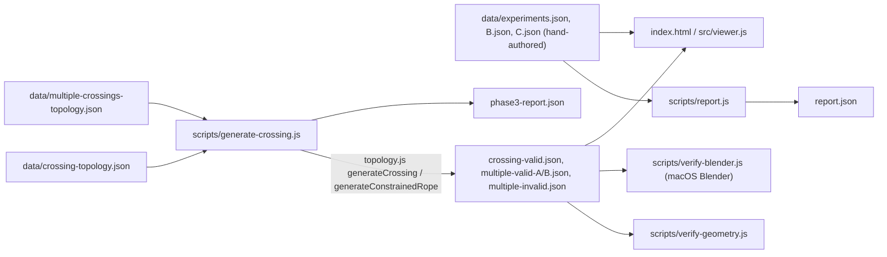
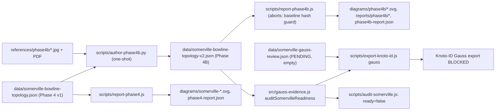
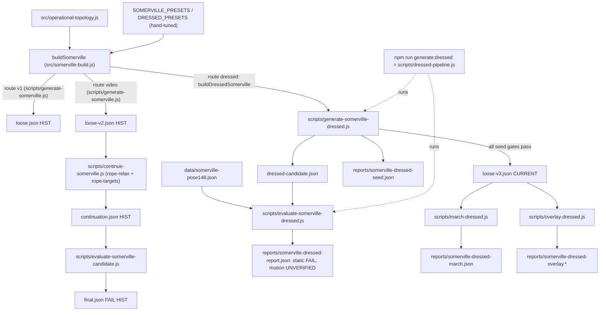
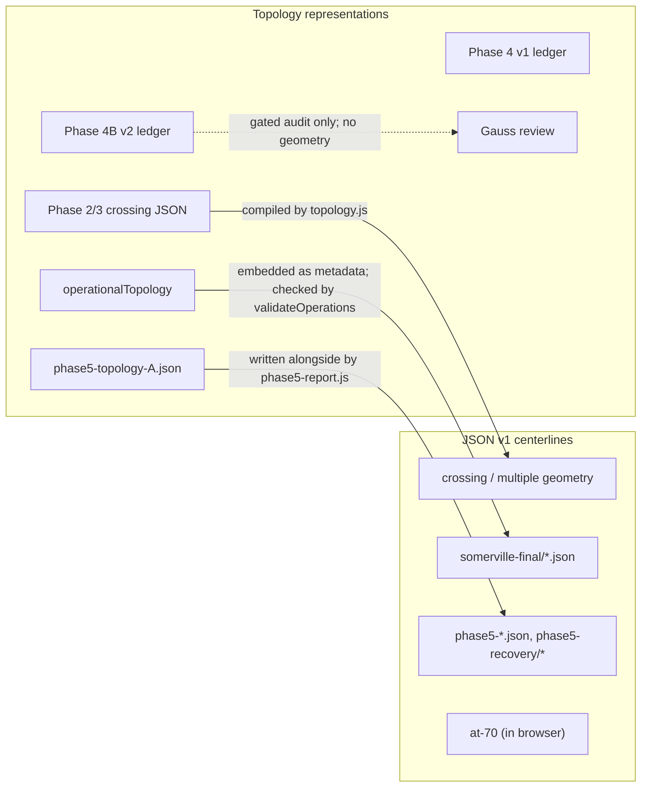
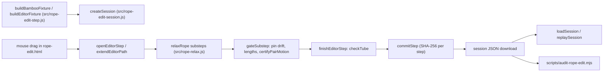

# Data Flow and Geometry/Topology Audit — Rope Geometry

Audit date 2026-11-17 (UTC+8). Branch `feature/somerville-egc-knoto-id` @ `397d350`.
Tags: **[V]** verified fact, **[I]** reasonable inference, **[U]** unknown.
Feature states: **IMPLEMENTED / PARTIAL / EXPERIMENTAL / BROKEN / PLANNED / UNKNOWN**.

A state of IMPLEMENTED means the code exists and is exercised by tests or by a command run during
this audit. It does **not** mean the result is topologically or physically correct. Three levels are
kept apart throughout:

1. Visually plausible geometry.
2. Geometrically valid geometry: no penetration, tube valid.
3. Topologically or source-verified geometry: the correct knot, matching the reference.

**No Somerville geometry in the repository reaches level 3** [V].

---

## 1. Pipelines that exist

### 1.1 Phase 1–3 proof of concept: topology → centerline → validation

This is the only place where an explicit topology record is compiled into geometry [V].

The construction is a linear path with a cosine elevation lift at each crossing
(`src/topology.js` `generateCrossing` l.12, `generateConstrainedRope` l.68). Validators check
projected crossing count, over/under order and capsule clearance separately (l.35, l.94, l.134, l.148) [V].

### 1.2 Somerville: evidence ledgers (no geometry output)

### 1.3 Somerville: centerline generation and evaluation

Observations:

- `opTopo` is the **only topology input**. The v2 evidence ledger (§1.2) never reaches this pipeline [V].
- `scripts/solve-somerville-pose.js` wraps `continue-somerville.js` + `evaluate-somerville-candidate.js` [V].
- `pose-videoTight-history.json` was produced by a solver now preserved only as `work/somerville/reuse/legacy-pose-solve.js` [V/I].

### 1.4 Topology-to-centerline mapping

Edges that are **missing** [V]:

- No converter from `led1` or `led2` to any centerline.
- No converter from a centerline to `gauss`. The geometry cannot be checked against a Gauss code inside this repo; Knoto-ID XYZ export exists for external analysis.
- No link between the at-70 hypotheses and the Somerville generators.

### 1.5 Semantic editor

### 1.6 Rendering and export

```mermaid
flowchart LR
  docs["JSON v1 documents in data/"] --> viewerI["src/viewer.js: capsule cylinders"]
  docs --> viewerP5["src/phase5-viewer.js: capsules + verifyGeometry live"]
  docs --> viewerS["src/somerville-viewer.js: makeTube + checkTube live"]
  model["src/at-70-model.js"] --> viewerA["src/at-70-viewer.js: capsules"]
  editorState["editor state"] --> viewerE["src/rope-editor.js: makeTube + hemp texture"]
  docs --> blenderImp["scripts/blender_import.py: POLY curve + bevel = diameter/2"]
  docs --> xyz["scripts/export-knoto-id.js xyz"]
  vite["vite build"] -->|"copies data, reports, diagrams, references"| dist["dist/ static site"]
```

Geometry is computed outside the renderers, except in the at-70 viewer and the editor, which build
their geometry from model code in the browser [V]. The renderers recompute validation live
(`verifyGeometry`, `checkTube`) instead of trusting stored reports. The exception is the Somerville
viewer, which merges `reports/somerville-dressed-report.json` when its SHA matches the candidate [V].

---

## 2. Writers of generated files [V]

| Output | Writer | npm script |
| --- | --- | --- |
| `report.json` | `scripts/report.js` | `report` |
| `data/crossing-valid.json`, `data/multiple-*.json`, `phase3-report.json` | `scripts/generate-crossing.js` | `report`, `generate:crossing` |
| `phase4-report.json`, `diagrams/somerville-*.svg` | `scripts/report-phase4.js` | `report:phase4` |
| `phase4b-report.json`, `diagrams/phase4b/*.svg`, `reports/phase4b/{material-ledger,crossing-traversal,evidence-index,review}.*` | `scripts/report-phase4b.js` | `report:phase4b` |
| `data/somerville-bowline-topology-v2.json` | `scripts/author-phase4b.py` | none |
| `data/phase5-{candidate-A,topology-A,partial-cuff}.json`, `reports/phase5/{validation,assumptions,material-ledger,partial-validation}.json` | `scripts/phase5-report.js` | `report:phase5` |
| `reports/phase5-recovery/{baseline,collisions,diagnosis}.*` | `scripts/recovery-diagnose.js` | `report:recovery` |
| `data/phase5-recovery/*.json`, `reports/phase5-recovery/{stage-*,integrated-trial,sampling,summary,local-core-material-ledger}.json`, `README.md` | `scripts/recovery-report.js` | `report:recovery` |
| `reports/phase5/blender-*.json` | `scripts/phase5-verify-blender.js` | `verify:blender:phase5` |
| `reports/verification/current.json` | `scripts/verify-geometry.js` | `verify:geometry` |
| `data/somerville-final/{loose,loose-v2}.json` | `scripts/generate-somerville.js` | none |
| `data/somerville-final/continuation.json`, `reports/somerville-continuation*.json` | `scripts/continue-somerville.js` | none |
| `data/somerville-final/final.json`, `reports/somerville-final-report.json` | `scripts/evaluate-somerville-candidate.js` | none |
| `data/somerville-final/{dressed-candidate,loose-v3}.json`, `reports/somerville-dressed-seed.json` | `scripts/generate-somerville-dressed.js` | `generate:dressed` |
| `reports/somerville-dressed-{report,metadata}.json` | `scripts/evaluate-somerville-dressed.js` | `generate:dressed` |
| `reports/somerville-dressed-march.json` | `scripts/march-dressed.js` | `march:dressed` |
| `reports/somerville-dressed-overlay.{png,svg,json}` | `scripts/overlay-dressed.js` | `overlay:dressed` |
| `data/rope-examples/overhand.json` | `scripts/generate-overhand.js` | none |
| `crossing-report.json`, `data/crossing-invalid.json`, `pose-videoTight-history.json`, `reports/somerville-videoTight-history.json`, `reports/rope-reuse-*.json`, `reports/somerville-dressed-baseline.json` | **no current writer** | — |

---

## 3. Geometry and topology audit

### A. Rope centerline

| Feature | State | Evidence |
| --- | --- | --- |
| Ordered XYZ points | **IMPLEMENTED** | `src/schema.js:validateDocument`; all 25 geometry docs validate (checked during audit) [V] |
| Continuous curve representation | **PARTIAL** | `src/rope-curves.js` (`hermitePoint`, `curvePoint` with line/hermite/torus-arc) is used **only at generation time**. Stored data is always a polyline. Somerville builders call `hermitePoint` ad hoc; only the overhand uses `compileRecipe` [V] |
| Arc-length parameterisation | **IMPLEMENTED** | `src/rope-state.js:geometryArc` (l.4) and fixed material coordinate `s0` (`createRopeState` l.5). Somerville docs carry `somerville.materialArc` [V] |
| Sampling / interpolation | **IMPLEMENTED (linear only)** | `materialSample`, `resampleMaterial` (`rope-state.js` l.14/l.19) and `evaluateAt` (`schema.js` l.27) are linear. `recovery-sampling.js:subdivide` is uniform linear [V] |
| Coordinate system and units | **IMPLEMENTED** | Metres, right-handed Z-up in every geometry doc [V]. Ledgers use pixels/ordinal units; pose annotation uses image pixels with px/m calibration (`somerville-pose148.json`) [V] |
| Radius / diameter | **IMPLEMENTED** | `diameter` stored; radius derived as `diameter/2` (`geometry.js`, `verification.js`, `makeTube(points, diameter/2)`, `somerville-dressed.js:dressedTube`). A diameter-as-radius bug in tube checks was fixed 2026-11-04 (`handoff.md`) [V] |
| Curve continuity | **PARTIAL** | Polylines are only C0. `verifyGeometry` reports polygonal smoothness. Dressed route adds fillets and local smoothing; v1 adds biharmonic fairing (`handoff.md`). "No C1 curve … has been proven" (`docs/cli-review.md`) [V]. `loose-v3` is on a knife-edge: −0.09 mm of `loopRadius` creates a tube fold (`handoff.md`, `reports/somerville-dressed-march.json`) [V] |
| Endpoint semantics | **PARTIAL** | The v2 ledger names ends E0/E1 neutrally and leaves them **unbound** (`endpoint-binding` unknown group) [V]. Generators treat tails as free, length-retargeted segments (`somerville-dressed.js`, `DRESSED_TOTAL_LENGTH` l.11). Editor uses pins [V] |

### B. Knot topology

| Feature | State | Evidence |
| --- | --- | --- |
| Crossing relationships: PoC | **IMPLEMENTED** | `topology.js`, 1–2 crossings, validated [V] |
| Crossing relationships: Somerville | **PARTIAL / incomplete** | v2 ledger records only two construction-state crossings `D8-X01/X02`. The FINAL inventory has 0 verified crossings (`audit:somerville`, run during audit) [V] |
| Over/under constraints | **IMPLEMENTED (PoC); PARTIAL (Somerville)** | PoC: `validateGeneratedCrossing`, `validateCrossingConstraints` [V]. Somerville: geometric proxies only (`diagonalOverFrontCuff`, `underCuffDirection`, `overRootBranches` in `somerville-verify.js:validateOperations`) [V] |
| Loop structure | **PARTIAL** | `validateOperations` checks loop aperture, first/second passage, under-all-four, two cuff turns, paired cuff order. Its own meaning string says it is route realisation, not isotopy [V] |
| Rope continuity | **IMPLEMENTED** | Single polyline per rope; `validateOperations` "single material path" [V]. The v2 FINAL graph is not a single E0→E1 path [V] |
| Topology preservation under motion | **PARTIAL** | `rope-relax.js:certifyPairMotion` (l.31) certifies linear vertex motion of centerline pairs and the column. "Full swept surface is not certified" [V]. Editor adds an aperture-passage check [V] |
| Knot identity / invariants | **PLANNED (external)** | Nothing computes a knot invariant from geometry. Gauss export is blocked; Knoto-ID is external and not bundled (`docs/somerville-egc-integration.md`) [V] |
| Knot-specific constraints | **IMPLEMENTED as numerical checks** | 9 final-operation checks pass on `loose-v3` (`reports/somerville-dressed-seed.json`; reproduced during audit) [V] |

### C. Collision and validation

| Feature | State | Evidence |
| --- | --- | --- |
| Segment-to-segment distance | **IMPLEMENTED (two kernels)** | `geometry.js:closestSegments` (frozen; near-parallel defect), `robust-distance.js:robustClosestSegments` [V] |
| Self-intersection: capsules | **IMPLEMENTED** | `detectCollisions`, `verifyGeometry` [V] |
| Self-intersection: tube mesh | **IMPLEMENTED (static)** | `rope-tube.js:checkTube` (l.53), `triangleIntersection` (l.30). The false positive fixed 2026-11-05 is covered by `test/rope-tube.test.js` [V] |
| Minimum clearance | **IMPLEMENTED** | Gap = `d − rA − rB`; Somerville gate 0.2 mm; `loose-v3` = +0.317 mm (reproduced) [V] |
| Adjacent-segment exclusion | **IMPLEMENTED (two incompatible policies)** | Index adjacency (`geometry.js`, `verification.js`) vs. `4·d` arc window (`rope-relax.js` l.61/l.87, `seedClearance`) [V] |
| Collision correction | **PARTIAL** | `relaxRope` resolves contacts by projection with a hard floor. The detectors never edit geometry (README). `integration-repair.js` refuses repair by policy [V] |
| Animation collision | **EXPERIMENTAL** | 16 uniform samples of linear keyframes (`schema.js:sampleAnimation`; README "can miss events") [V] |
| Swept-tube continuous collision | **PLANNED** | Repeatedly listed as missing (`handoff.md`, `reports/rope-edit/README.md`, `rope-relax.js` l.320) [V] |
| Sampling independence | **PARTIAL** | `loose-v3` tube valid at 8/12/16/24 radial segments (`reports/somerville-dressed-seed.json`, `tube.radialSweep`). Capsule counts depend on subdivision (`docs/cli-review.md`) [V] |
| Cross-platform reproducibility | **BROKEN at bit level** | The dressed pipeline on Linux gives the same results but different bytes (max coordinate difference 6.7e-16 m). `test/rope-core.test.js` fails bit-exact comparison (§4) [V] |

### D. Rope surface geometry

| Feature | State | Evidence |
| --- | --- | --- |
| Tube generation | **IMPLEMENTED** | `rope-tube.js:makeTube` (l.8), default 12 radial segments, end caps [V] |
| Three-strand helical construction | **Absent geometrically; EXPERIMENTAL as a texture** | No helix/strand geometry in `src/`. `rope-editor.js` draws a procedural 3-strand bump texture (visual only). `material-hemp-6mm.json` has `strandGeometryExplicit:false`. `docs/somerville-egc-integration.md` says strands will be effective parameters, "not explicitly meshed" [V]. Not scheduled anywhere [V] |
| Parallel-transport frames | **IMPLEMENTED** | `rope-frames.js:rotationMinimizingFrames` (l.10); shared by tube and Somerville ribbon (extraction preserved hashes per `handoff.md`) [V] |
| Mesh reconstruction | **IMPLEMENTED (two paths)** | Three.js tube (`makeTube`) and Blender bevel curves (`blender_import.py`, PoC/Phase 5 only). README notes that bevel corners need not equal a union of capsules [V] |
| Surface continuity | **PARTIAL** | Fold-face detection (`checkTubeLocal` l.46) is the proxy. No analytic smoothness guarantee [V] |
| Somerville two-strand ribbon | **IMPLEMENTED** | The doubled working bundle is generated as a ribbon with `rollAnchors` (`somerville-build.js`, `somerville-dressed.js`). This is two rope passes, **not** a laid-strand construction [V] |

### E. Animation

| Feature | State | Evidence |
| --- | --- | --- |
| Static vs time-varying centerlines | **IMPLEMENTED (schema), little used** | `animation.frames` with linear interpolation; only `data/C.json` uses it [V]. No Somerville animation document exists [V] |
| Correspondence between frames | **IMPLEMENTED** | Fixed point counts (schema) and fixed material coordinate `s0` (`rope-state.js`); editor steps store accepted frames and SHA [V] |
| Topology preservation during deformation | **PARTIAL** | Editor and continuation use centerline CCD (`certifyPairMotion`) plus end-of-step tube checks; no swept-tube proof [V] |
| Loose-to-tight transformation | **EXPERIMENTAL, target not reached** | PBD shortening (`final.json`) FAIL; length-preserving continuation moved at most about 3.1 mm (`handoff.md`); dressed parameter march stalls (`loopRadius`, `rootDepth` zero progress; `reports/somerville-dressed-march.json`) [V] |
| Procedural vs physics-generated motion | **Procedural/geometric only** | `rope-relax.js` is a geometric solver. Physics (Cosserat) is PLANNED, with every parameter `null` (`material-hemp-6mm.json`) [V] |
| Editor timeline playback | **IMPLEMENTED (prototype)** | `rope-edit-session.js:playbackFrames`, `replaySession`; 3 sessions re-verified (`audit-rope-edit.mjs`, run during audit) [V] |

---

## 4. Reproducibility of generated data (runs observed during this audit)

All runs happened in a disposable `git archive` copy under `/tmp` (Linux, Node 22.23.4). The
repository was not modified [V].

| Command | Exit | Output vs committed |
| --- | --- | --- |
| `npm run report` | 0 | Identical |
| `npm run report:phase4` | 0 | Identical |
| `npm run report:phase4b` | **1** | Aborts: "Previous foundation modified". `src/topology.js` does not match `reports/phase4b/baseline-sha256.json`, although the file is unchanged since the initial commit `730c3a2` |
| `npm run report:phase5` | 0 | 3 files differ in the last floating-point digit (for example `0.05785088487178853` → `…852`) |
| `npm run report:recovery` | 0 | Identical |
| `npm run verify:geometry` | 0 | `reports/verification/current.json` identical |
| `node scripts/generate-overhand.js` | 0 | 3 coordinates differ, at most 6.9e-18 m |
| `node scripts/generate-somerville.js` | 0 | `loose.json` / `loose-v2.json` differ, at most 6.5e-16 m / 2.8e-16 m |
| `npm run generate:dressed` (2 min 35 s) | 0 | Same outcome (seed frozen, gap 0.317 mm, RMS 109.44 px), but `loose-v3.json` SHA `8eeab346…` instead of the recorded `ea7676ee…`; at most 6.7e-16 m |
| `node scripts/audit-rope-edit.mjs reports/rope-edit/session{1,2,3}.json` | 0 | All `verified:true`, `hashesMatch:true` |

Interpretation [I]: the recorded SHAs were produced on macOS (paths in `handoff.md` and the
`sips`/Blender paths). Floating-point transcendental results differ between platforms at the last
bit, so SHA-based reproducibility claims hold per-platform only.
